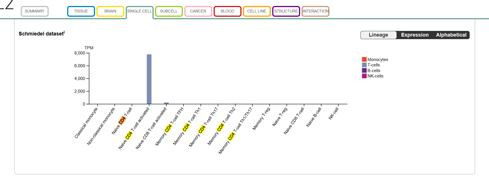
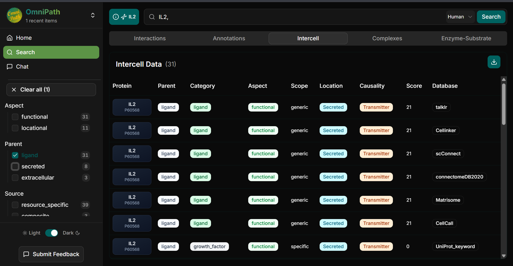
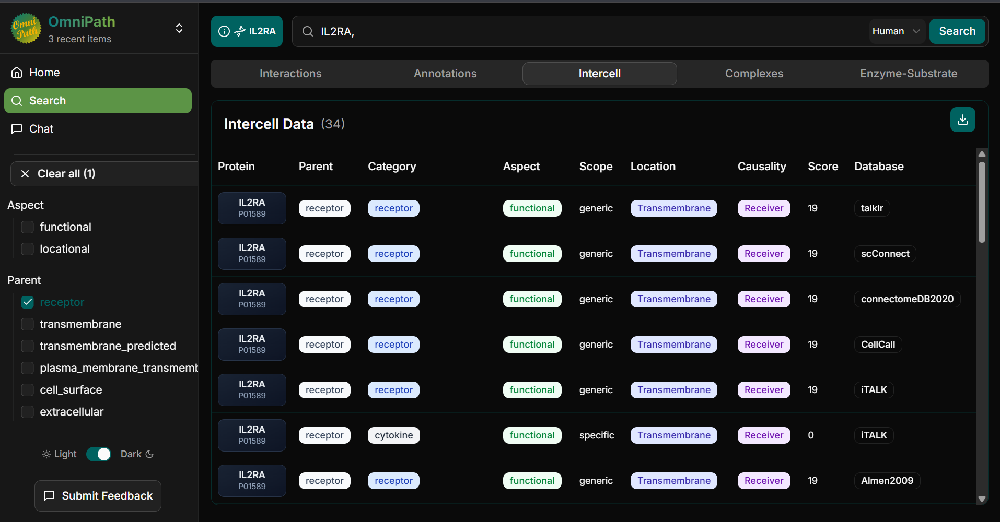
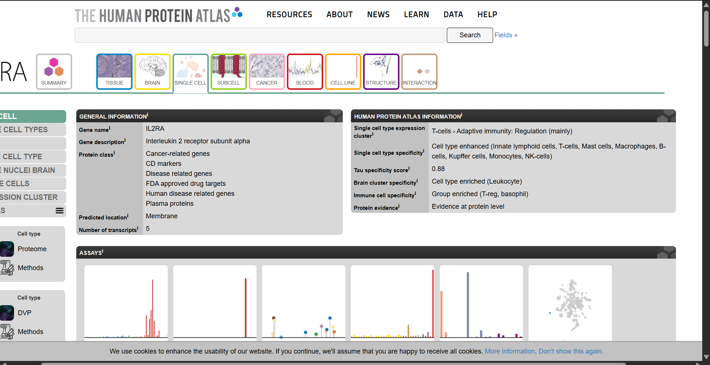
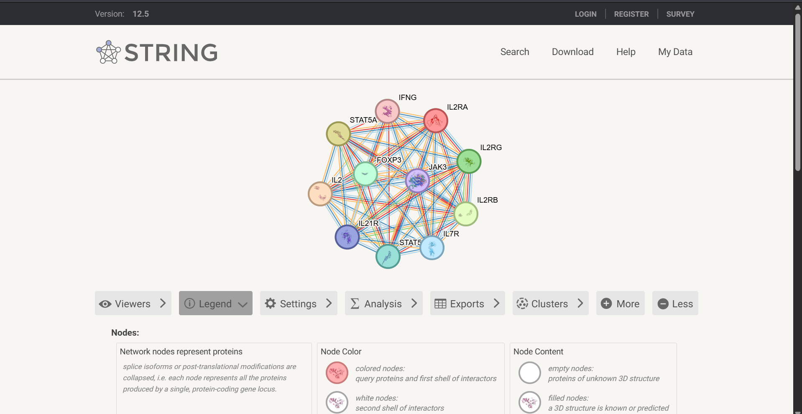
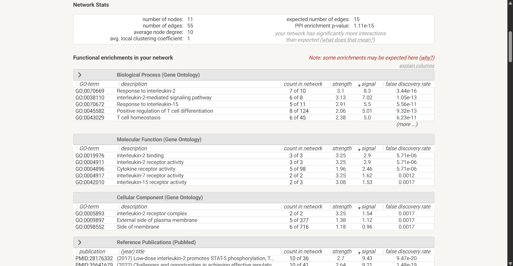

# Cell-to-Cell Communication: CD4+ Helper T Cell

## Biological Question
How do activated CD4+ helper T cells communicate with other immune cells through cytokine signaling?

## Part A. Sender Cell and Biological Context

**Sender Cell:** CD4+ Helper T Cell  
**Organism:** *Homo sapiens*  
**Biological Context:** Immune activation

CD4+ helper T cells are immune cells that coordinate immune responses by producing cytokines. These signaling molecules help regulate the activation, proliferation, and functions of other immune cells.

## Part B. Candidate Ligand and Sender-Cell Evidence

**Candidate Ligand:** Interleukin-2 (IL-2)  
**Official Gene Symbol:** IL2  
**Protein Type:** Secreted cytokine  
**Database:** Human Protein Atlas (HPA)  
**Dataset:** Schmiedel RNA-seq

### Expression Evidence

The Human Protein Atlas Schmiedel dataset shows high IL2 RNA expression in activated naive CD4+ T cells, approximately 7,800 TPM, compared with very low expression in resting naive CD4+ T cells.

This supports the selection of IL-2 as a candidate signaling molecule produced by activated CD4+ helper T cells. The RNA expression data support the biological plausibility of IL-2 production but do not directly measure protein secretion.

### Evidence Screenshot

### Reference

Human Protein Atlas. IL2 (Interleukin-2).

https://www.proteinatlas.org/ENSG00000109471-IL2

## Part C. Receptor and Receiver Cell Identification

### Proposed Cell-to-Cell Communication

**Sender Cell:** Activated CD4+ helper T cell  
**Ligand:** Interleukin-2 (IL-2)  
**Receptor:** IL-2 receptor complex (IL2RA, IL2RB, IL2RG)  
**Receiver Cell:** Regulatory T cell (Treg)  
**Signaling Type:** Paracrine  
**Biological Context:** Immune regulation

### OmniPath Findings

OmniPath classifies IL2 (UniProt: P60568) as a secreted ligand with a transmitter role in intercellular communication.

IL2RA (UniProt: P01589) is classified as a transmembrane receptor with a receiver role. IL2RA is the alpha subunit of the high-affinity IL-2 receptor complex, which also includes IL2RB and IL2RG.

**IL2 Ligand Evidence:**

**IL2RA Receptor Evidence:**

### Receiver Cell Evidence

The Human Protein Atlas identifies IL2RA as group enriched in regulatory T cells (Tregs) and basophils. Its predicted membrane localization supports its function as a cell-surface receptor component.

This provides evidence that regulatory T cells are biologically reasonable receivers of IL-2 signaling.

### Proposed Signaling Mechanism

Activated CD4+ helper T cells secrete IL-2, which can bind to the IL-2 receptor complex on regulatory T cells. This signaling contributes to regulatory T-cell survival and immune regulation.

The proposed communication is paracrine because IL-2 is released by the sender cell and acts on a nearby receiver cell.

### References

- Human Protein Atlas — IL2RA: https://www.proteinatlas.org/ENSG00000134460-IL2RA
- OmniPath Explorer: https://explore.omnipathdb.org/
- UniProt — IL2: https://www.uniprot.org/uniprotkb/P60568/entry
- UniProt — IL2RA: https://www.uniprot.org/uniprotkb/P01589/entry

## Part D. STRING Protein Interaction Network Analysis

### Database and Search Information

**Database:** STRING v12.5  
**Query Protein:** IL2RA (Interleukin-2 receptor subunit alpha)  
**Organism:** *Homo sapiens*  
**Analysis:** Protein–protein association network and functional enrichment

### Network Results

The STRING analysis generated a network containing 11 proteins and 55 functional associations.

| Network Statistic | Result |
|---|---|
| Number of nodes | 11 |
| Number of edges | 55 |
| Expected number of edges | 15 |
| Average node degree | 10 |
| Average local clustering coefficient | 1 |
| PPI enrichment p-value | 1.11 × 10⁻¹⁵ |

The network contains significantly more functional associations than expected by chance, suggesting that the proteins are biologically connected. STRING associations do not necessarily represent direct physical interactions.

### STRING Network Visualization

### Important Proteins and Their Functions

| Protein | Function |
|---|---|
| IL2RA | Alpha subunit of the IL-2 receptor complex |
| IL2RB | Receptor subunit involved in IL-2 signaling |
| IL2RG | Common gamma chain involved in cytokine receptor signaling |
| JAK3 | Protein kinase involved in intracellular signaling |
| STAT5A | Transcription factor activated downstream of IL-2 signaling |
| FOXP3 | Transcription factor important for regulatory T-cell identity and function |

### Functional Enrichment Analysis

The STRING network showed significant enrichment in biological processes related to interleukin-2 signaling and T-cell regulation.

| Biological Process | GO Identifier | False Discovery Rate |
|---|---|---|
| Response to interleukin-2 | GO:0070669 | 3.44 × 10⁻¹⁶ |
| Interleukin-2-mediated signaling pathway | GO:0038110 | 1.05 × 10⁻¹³ |
| Positive regulation of T-cell differentiation | GO:0045582 | 9.32 × 10⁻¹³ |
| T-cell homeostasis | GO:0043029 | 6.23 × 10⁻¹¹ |

**Selected Enriched Pathway:** Interleukin-2-mediated signaling pathway (GO:0038110).

This pathway is relevant because IL-2 binds to its receptor complex and activates intracellular signaling that contributes to T-cell survival, proliferation, and immune regulation.

### Functional Enrichment Evidence

### Interpretation

The STRING network supports the biological association of IL2RA with other proteins involved in cytokine signaling. IL2RA, IL2RB, and IL2RG form the high-affinity IL-2 receptor complex. Downstream signaling involves proteins such as JAK3 and STAT5, while FOXP3 is important for regulatory T-cell identity and function.

These results support the proposed IL-2 communication pathway between activated CD4+ helper T cells and regulatory T cells.

### Reference

STRING Database: https://string-db.org/

## Part E. IntAct Molecular Interaction Validation

### Database and Search Information

**Database:** IntAct Molecular Interaction Database  
**Query Protein:** IL2RA (UniProt: P01589)  
**Organism:** *Homo sapiens*  
**Downloaded Format:** PSI-MI TAB 2.7

### Experimental Interaction Evidence

The IntAct search identified experimental interaction records involving IL2RA. The downloaded dataset contains 47 interaction records, including three records supporting an interaction between IL-2 (P60568) and IL2RA (P01589).

### Relevant Experimental Methods

| Detection Method | Publication |
|---|---|
| Molecular sieving | PMID: 16477002 |
| X-ray crystallography | PMID: 16477002 |
| Solid-phase assay | PMID: 17032757 |

The relevant records reported an MI score of 0.67.

### Interpretation

The IntAct evidence supports a physical interaction between IL-2 and IL2RA, strengthening the proposed ligand–receptor relationship.

Unlike STRING, which reports functional protein associations, IntAct provides experimental interaction records with specific detection methods and supporting publications.

These findings support the proposed communication between activated CD4+ helper T cells and regulatory T cells through IL-2 receptor signaling. However, the molecular interaction records alone do not establish that this communication occurs between those specific cell populations.

### Downloaded Interaction Data

[View IntAct Interaction Dataset](data/07_intact_interactions.tsv)

### Reference

IntAct Molecular Interaction Database: https://www.ebi.ac.uk/intact/

## Part F. Final Cell-to-Cell Communication Model

### Final Signaling Diagram

*Diagram to be uploaded after completion.*

### Interpretation

The proposed cell-to-cell communication model involves an activated CD4+ helper T cell as the sender and a regulatory T cell (Treg) as the receiver. The sender cell produces interleukin-2 (IL-2), a signaling protein that can bind to the IL-2 receptor complex on regulatory T cells. This interaction represents paracrine signaling because IL-2 acts on a nearby cell.

Evidence from the Human Protein Atlas supports IL2 expression in activated CD4+ T cells and IL2RA expression in regulatory T cells. OmniPath provides supporting information about the signaling roles of IL-2 and its receptor. The STRING network identifies functionally associated proteins, including IL2RA, IL2RB, IL2RG, JAK3, STAT5A, and STAT5B. Its enriched pathways include IL-2-mediated signaling and T-cell homeostasis. IntAct provides experimental molecular-interaction evidence supporting the relationship between IL-2 and IL2RA.

Based on the established IL-2 signaling mechanism, receptor activation can trigger JAK–STAT5 signaling, contributing to regulatory T-cell survival, proliferation, and immune regulation. However, the database findings do not directly demonstrate communication between these two specific cell populations under the same experimental conditions. Therefore, the final model represents a biologically supported interpretation rather than a directly observed cell-to-cell interaction.

## Part G. Guide Questions and Answers

### 1. What sender cell did you choose, and in what tissue or biological context does it act?

The selected sender cell is an activated CD4+ helper T cell in humans. It functions during immune activation by producing cytokines that help coordinate immune responses.

### 2. What signaling molecule did you identify, and what evidence supports its production or presentation by the sender cell?

The signaling molecule is interleukin-2 (IL-2), encoded by the IL2 gene. The Human Protein Atlas Schmiedel RNA-seq dataset showed approximately 7,800 TPM of IL2 RNA in activated naive CD4+ T cells, supporting its potential production. However, RNA expression does not directly confirm protein secretion.

### 3. What receptor receives the signal, and which receiver cell did you select?

The receptor is the IL-2 receptor complex, consisting of IL2RA, IL2RB, and IL2RG. The selected receiver cell is the regulatory T cell (Treg). Human Protein Atlas data support IL2RA expression in Tregs.

### 4. What type of cell-to-cell signaling is represented?

The proposed mechanism is paracrine signaling because activated CD4+ helper T cells release IL-2, which can act on nearby regulatory T cells.

### 5. Which proteins in your STRING network appear most relevant to the receptor-associated response? Explain briefly.

The most relevant proteins are IL2RA, IL2RB, IL2RG, JAK3, and STAT5A. The first three form the receptor complex, JAK3 participates in intracellular signaling, and STAT5A regulates gene expression downstream of IL-2 receptor activation.

### 6. What enriched pathway or biological process is consistent with your proposed mechanism?

The interleukin-2-mediated signaling pathway (GO:0038110) is consistent with the model. The STRING analysis reported a false discovery rate of 1.05 × 10⁻¹³, supporting significant enrichment of this pathway in the analyzed network.

### 7. What did IntAct show for the molecular interaction you examined? What type of evidence was reported?

The IntAct dataset contained three reported interaction records between IL-2 and IL2RA. The listed experimental methods included molecular sieving, X-ray crystallography, and solid-phase assay, with an MI score of 0.67. These records support a physical ligand–receptor interaction but do not directly establish communication between the selected cell types.

### 8. Which parts of your final model are strongly supported, and which parts remain an inference?

Database evidence supports IL2 RNA expression in activated CD4+ T cells, IL2RA expression in regulatory T cells, and molecular associations involving IL-2 signaling proteins. However, actual IL-2 secretion, signaling between the selected cells under the same conditions, and the resulting cellular response remain inferences based on the proposed mechanism.

### 9. What cellular response is expected in the receiver cell, and why?

The expected response is increased regulatory T-cell survival, proliferation, and immune-regulatory activity. IL-2 receptor signaling activates the JAK–STAT5 pathway, which helps maintain regulatory T-cell function and immune balance.

## References

1. Human Protein Atlas. IL2 (Interleukin-2). https://www.proteinatlas.org/ENSG00000109471-IL2

2. Human Protein Atlas. IL2RA (Interleukin-2 Receptor Subunit Alpha). https://www.proteinatlas.org/ENSG00000134460-IL2RA

3. OmniPath Explorer. https://explore.omnipathdb.org/

4. STRING Database. https://string-db.org/

5. IntAct Molecular Interaction Database. https://www.ebi.ac.uk/intact/

6. UniProt. IL2 (P60568). https://www.uniprot.org/uniprotkb/P60568/entry

7. UniProt. IL2RA (P01589). https://www.uniprot.org/uniprotkb/P01589/entry
